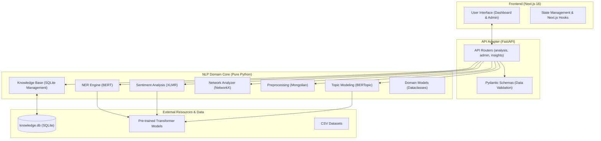

# NLP Intelligence — Project Overview & Architecture

This project is a sophisticated NLP (Natural Language Processing) analysis platform specifically tailored for the Mongolian language. It uses a **Hexagonal Architecture** (also known as Ports and Adapters) to ensure that the core NLP logic remains independent of the web framework, making it highly maintainable and testable.

## 1. System Architecture

The following diagram illustrates the high-level architecture of the system:

---

## 2. Component Breakdowns

### 🟢 Frontend: Next.js + Tailwind CSS
*   **Location**: `frontend/`
*   **Tech Stack**: Next.js 16, TypeScript, Tailwind CSS, Lucide Icons, Recharts (for visualizations).
*   **What it does**:
    *   **Dashboard ([page.tsx](file:///home/nomio/Documents/%D0%91%D0%A1%D0%90/NLP-intelligence/frontend/src/app/page.tsx))**: Provides the main interface for users to upload CSVs or paste text. It visualizes sentiment distribution, named entities, and network co-occurrence charts.
    *   **Admin (`admin/page.tsx`)**: An interface to manage the "Knowledge Base" (labels, stopwords, and category hierarchies) which helps the NLP engine categorize text better.
    *   **Design System ([globals.css](file:///home/nomio/Documents/%D0%91%D0%A1%D0%90/NLP-intelligence/frontend/src/app/globals.css))**: Implements a premium "Glassmorphism" dark-mode theme.

### 🔵 API Adapter: FastAPI
*   **Location**: `adapters/api/`
*   **What it does**:
    *   **Routers**: 
        *   [analysis.py](file:///home/nomio/Documents/%D0%91%D0%A1%D0%90/NLP-intelligence/adapters/api/routers/analysis.py): Handles file uploads and orchestrates the NLP pipeline (Preproc -> NER -> Sentiment -> Topic -> Network).
        *   [admin.py](file:///home/nomio/Documents/%D0%91%D0%A1%D0%90/NLP-intelligence/adapters/api/routers/admin.py): Provides CRUD endpoints for the Knowledge Base.
        *   [insights.py](file:///home/nomio/Documents/%D0%91%D0%A1%D0%90/NLP-intelligence/adapters/api/routers/insights.py): Generates higher-level insights from raw analysis results.
    *   **Schemas**: Uses Pydantic to strictly define how data enters and leaves the API.

### 📦 NLP Domain Core: Pure Python logic
*   **Location**: `nlp_core/`
*   **Key Modules**:
    *   **[preprocessing.py](file:///home/nomio/Documents/%D0%91%D0%A1%D0%90/NLP-intelligence/nlp_core/preprocessing.py)**: The "entry gate" for text. Cleans Mongolian text, removes punctuation, and filters out "stopwords" (common words like "байна", "болох" which don't add meaning).
    *   **[ner_engine.py](file:///home/nomio/Documents/%D0%91%D0%A1%D0%90/NLP-intelligence/nlp_core/ner_engine.py)**: Extracts Named Entities (Names, Places, Orgs). Uses the multilingual BERT model.
    *   **[sentiment.py](file:///home/nomio/Documents/%D0%91%D0%A1%D0%90/NLP-intelligence/nlp_core/sentiment.py)**: Classifies text as Positive, Negative, or Neutral.
    *   **[topic_modeler.py](file:///home/nomio/Documents/%D0%91%D0%A1%D0%90/NLP-intelligence/nlp_core/topic_modeler.py)**: Clusters large datasets into high-level "topics" using BERTopic.
    *   **[network_analyzer.py](file:///home/nomio/Documents/%D0%91%D0%A1%D0%90/NLP-intelligence/nlp_core/network_analyzer.py)**: Identifies which words or entities appear together frequently, building a "co-occurrence graph".
    *   **[models.py](file:///home/nomio/Documents/%D0%91%D0%A1%D0%90/NLP-intelligence/nlp_core/models.py)**: Defines the "language" of the domain using Python `dataclasses`.

---

## 3. How It Works (The Lifecycle of a Request)

1.  **Input**: A user uploads a CSV in the Frontend.
2.  **API Call**: The Frontend sends this CSV to `POST /api/upload`.
3.  **Preprocessing**: The engine cleans the text using [preprocessing.py](file:///home/nomio/Documents/%D0%91%D0%A1%D0%90/NLP-intelligence/nlp_core/preprocessing.py).
4.  **NER & Sentiment**: Each sentence is run through BERT models in parallel to extract entities and sentiment.
5.  **Topic & Graphing**: If it's a large file, [topic_modeler.py](file:///home/nomio/Documents/%D0%91%D0%A1%D0%90/NLP-intelligence/nlp_core/topic_modeler.py) clusters messages, and [network_analyzer.py](file:///home/nomio/Documents/%D0%91%D0%A1%D0%90/NLP-intelligence/nlp_core/network_analyzer.py) builds relationship graphs.
6.  **Response**: The API returns a structured JSON object containing all these insights.
7.  **Visualization**: The Frontend renders charts (Pie charts for sentiment, Treemaps for topics, Network graphs for relationships).

---

## 4. Development & Modification Guide

If you want to make changes, here is where to look:

| If you want to... | File(s) to modify |
| :--- | :--- |
| **Change the UI colors / Layout** | [frontend/src/app/globals.css](file:///home/nomio/Documents/%D0%91%D0%A1%D0%90/NLP-intelligence/frontend/src/app/globals.css) or [layout.tsx](file:///home/nomio/Documents/%D0%91%D0%A1%D0%90/NLP-intelligence/frontend/src/app/layout.tsx) |
| **Add a new chart to Dashboard** | [frontend/src/app/page.tsx](file:///home/nomio/Documents/%D0%91%D0%A1%D0%90/NLP-intelligence/frontend/src/app/page.tsx) (using Recharts) |
| **Improve Mongolian text cleaning** | [nlp_core/preprocessing.py](file:///home/nomio/Documents/%D0%91%D0%A1%D0%90/NLP-intelligence/nlp_core/preprocessing.py) |
| **Switch to a better BERT model** | [nlp_core/ner_engine.py](file:///home/nomio/Documents/%D0%91%D0%A1%D0%90/NLP-intelligence/nlp_core/ner_engine.py) or [sentiment.py](file:///home/nomio/Documents/%D0%91%D0%A1%D0%90/NLP-intelligence/nlp_core/sentiment.py) |
| **Add a new API endpoint** | [adapters/api/routers/analysis.py](file:///home/nomio/Documents/%D0%91%D0%A1%D0%90/NLP-intelligence/adapters/api/routers/analysis.py) |
| **Modify how entities are saved** | [nlp_core/models.py](file:///home/nomio/Documents/%D0%91%D0%A1%D0%90/NLP-intelligence/nlp_core/models.py) |

---

## 5. Potential Improvements

1.  **Asynchronous Processing**: Currently, large CSVs might time out the request. Implementing **Celery + Redis** would allow "background processing" where the user uploads a file and gets notified when it's done.
2.  **Custom LLM Integration**: Adding a module to use GPT-4 or a local Llama model for "Summarization" of the extracted topics.
3.  **Advanced Network Visuals**: Switching from static JSON-based graphs to a truly interactive canvas using **D3.js** or **React Force Graph** in the frontend.
4.  **Database Migration**: Moving from SQLite to **PostgreSQL** if you plan to store thousands of analysis results over time.
